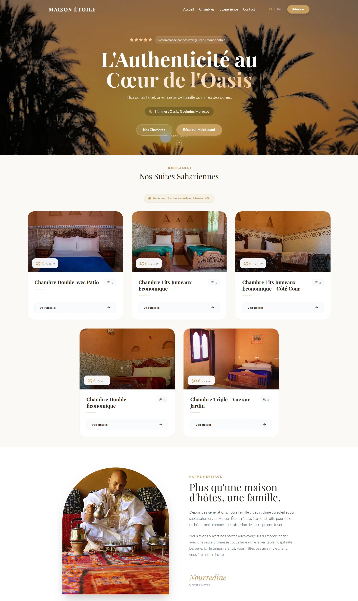

# 🏜️ Maison Étoile du Désert | Luxury Guesthouse SPA

> A high-performance, conversion-optimized Single Page Application (SPA) built for a luxury Saharan guesthouse.

 

🔗 **Live Demo:** https://maison-etoile-du-desert-statique.vercel.app/

---

## 📖 Project Overview & Business Strategy

This project started as a Full-Stack application (Laravel + React/Redux) but was strategically **pivoted to a Static SPA** to better serve the client's business needs. 

For a boutique hotel in the Moroccan desert, the priorities are **speed, flawless SEO, and direct conversion**. By removing the backend latency and implementing a **"WhatsApp-First"** booking funnel, this architecture maximizes direct reservations while eliminating server costs and database security vulnerabilities.

---

## ✨ Key Features & UX Highlights

- **WhatsApp-First Conversion:** Frictionless booking flow. Room details and experiences dynamically generate pre-filled WhatsApp messages to the host.
- **Multilingual (i18n):** Full English and French support using `react-i18next` with automatic language detection to cater to international tourists.
- **Luxury UI/UX Design:** Custom design system built with Tailwind CSS. Features include a transparent-to-solid sticky navbar, "Bento Grid" photo galleries, and smooth layout animations.
- **Interactive Image Lightbox:** Custom full-screen gallery for an immersive visual experience.
- **Smart Components:** 
  - "FOMO" scarcity badges (*"Only 5 suites available"*).
  - Dynamic Google Maps integration for remote desert location finding.
- **Technical SEO:** Implemented Open Graph (OG) tags for social media sharing, `robots.txt`, and `sitemap.xml`.

---

## 🛠️ Tech Stack

- **Framework:** React.js (Bootstrapped with Vite for instant server start & optimized builds)
- **Styling:** Tailwind CSS (Custom thematic configuration)
- **Routing:** React Router v6
- **Internationalization:** `react-i18next` & `i18next-browser-languagedetector`
- **Icons:** Lucide React & Native SVGs
- **Data Architecture:** Serverless (Local JSON state simulating a decoupled Headless CMS)

---

## 🧠 Architectural Decisions

1. **Zero-State Management:** Removed Redux Toolkit during the strategic pivot. Since the data is static and localized, React's native `useState` and prop drilling were sufficient and drastically reduced the bundle size.
2. **Component Reusability (DRY):** Built atomic UI components (`<Button />`, `<RoomCard />`, `<TestimonialCard />`) to ensure strict consistency across the application.
3. **Optimized Rendering:** Prevented scroll-lag (Layout Thrashing) by applying `{ passive: true }` to event listeners and utilizing CSS transforms instead of height animations for the Navbar.

---

## 🚀 Run Locally

To run this project on your local machine:


1. Clone the repository:
```bash

git clone https://github.com/ABDELMAJID18990/Maison-etoile-du-desert-statique
```

2. Navigate to the project directory:
```bash

cd maison-etoile-statique
```

3. Install dependencies:
```bash
npm install
```

4. Start the development server:
```bash
npm run dev
```

---


## 👨‍💻 Auteur

**Abdelmajid El ainousi** 
Développeur Full-Stack passionné par la création d'applications web modernes et performantes.
 

[🌐 Mon Portfolio](https://elainousi-portfolio.vercel.app/) | [💼 Mon LinkedIn](https://www.linkedin.com/in/abdelmajid-el-ainousi/)

Developed with ❤️ in GUELMIM